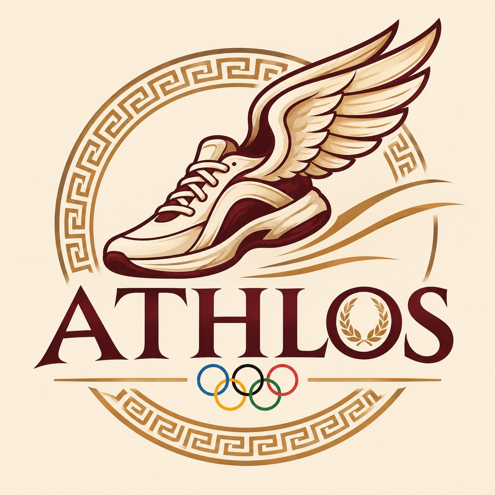

# ATHLOS
### Un viaje por la historia de los Juegos Olímpicos

---

## Creadores del proyecto

<table>
  <tr>
    <td align="center" width="50%">
       
      <strong>Maria Clara Gómez</strong> 
      Ingeniería Industrial 
      Universidad de Antioquia  
      Se destaca por su creatividad y responsabilidad. Tiene facilidad para trabajar en equipo, redactar e investigar información, además de aportar ideas relacionadas con el diseño y la presentación del proyecto.
    </td>
    <td align="center" width="50%">
       
      <strong>Daniel Montoya</strong> 
      Ingeniería Industrial 
      Universidad de Antioquia  
      Se destaca por su capacidad de análisis y organización. Tiene habilidades en programación y trabajo en equipo, y aporta responsabilidad y disposición para resolver los retos que se presentan durante el desarrollo del proyecto.
    </td>
  </tr>
</table>

---

### Vínculos académicos
- **Universidad:** Universidad de Antioquia.
- **Programa académico:** Ingeniería Industrial.
- **Asignatura:** Algoritmia y Programación.
- **Profesora:** Cindy Natally Estrada Jiménez.

Este proyecto se desarrolla como parte de las actividades académicas de la asignatura Algoritmia y Programación.

---

### *Nombre y detalles del proyecto*

**Nombre del proyecto:** *ATHLOS.*

**Logo:** 

  

---

### Descripción

ATHLOS es una aplicación enfocada en explorar la historia de los Juegos Olímpicos a través de los datos de sus participantes.

La aplicación permitirá consultar información sobre los atletas, sus características, los países que representan, los deportes en los que compiten y las medallas obtenidas a lo largo de las diferentes ediciones de los Juegos Olímpicos.

Además, contará con herramientas para explorar los datos y un espacio de juego relacionado con la información de la base de datos.

---

### *Reporte de visión*

### Descripción general

ATHLOS busca ofrecer una forma sencilla e interactiva de conocer la historia de los Juegos Olímpicos mediante la exploración de datos de sus participantes.
La aplicación permitirá consultar información de diferentes ediciones de los Juegos, conocer datos de los atletas, comparar resultados y descubrir información interesante sobre los países, deportes y medallas.

### Objetivo general

Desarrollar una aplicación que permita explorar y comprender la información histórica de los Juegos Olímpicos mediante herramientas de consulta, análisis y actividades interactivas.

### Objetivos específicos

- Organizar y presentar información histórica de los Juegos Olímpicos.
- Facilitar la consulta de atletas, países, deportes y medallas.
- Permitir la exploración de datos mediante filtros, estadísticas y gráficos.
- Crear un espacio de juego relacionado con la información de los Juegos Olímpicos.

### Beneficios

- Facilita el acceso a información histórica del deporte.
- Permite conocer y comparar la participación de diferentes países y atletas.
- Presenta los datos de una manera visual e interactiva.
- Promueve el aprendizaje mediante la exploración y el juego.